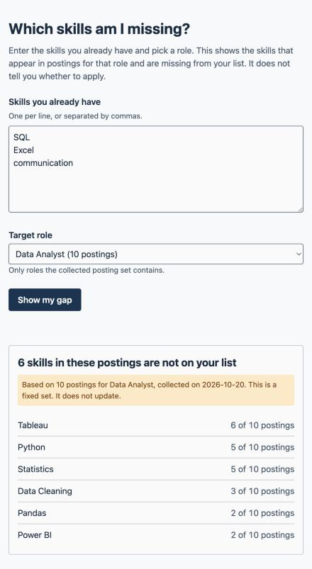

# Team Gamma: Which Skills Employers Actually Want

Students cannot tell which skills the roles they want ask for. This repository holds our specification, our decisions, a deployed first build, and the evals we ran against it.

## What

A student picks a target role, types the skills they already have, and sees the skills missing from their list, ordered by how many postings ask for each. Phase 2 deployed the first part of that: F1, the skill gap for a role.

**Deployed:** https://mgt3745-team-gamma.mgt3745-hw5.workers.dev

**Recording:** [link coming after we record]

## Team

| Member | GitHub | Phase 1 | Phase 2 | Final |
|---|---|---|---|---|
| Aaron Rahim | @aaronsarasota04 | Implementer | Architect | Reviewer |
| Prince Muteteke | @Daedruoy | Specifier | Reviewer and Evaluator | Architect |
| Ryan Linde | @ryanlinde-gif | Architect | Implementer | Specifier |
| Canon Anderson | @cad3nnn | Reviewer | Specifier | Implementer |

Nuhamin Gebre left the course on 2026-10-20, so the team is four. Roles, the RACI matrix, and the meeting log are in [TEAM.md](TEAM.md).

## Status

**Built.** One Cloudflare Worker with a D1 database serves two routes, `GET /api/roles` and `POST /api/gaps`, and a static page calls it. The deployed set is 28 synthetic postings across three roles (Frontend Developer 12, Data Analyst 10, IT Support Specialist 6). The Worker calls no outside service, refuses every write, and stores nothing a student types.

**Which features pass which evals.**

| Feature | Evals | Result |
|---|---|---|
| F1, skill gap for a role | E1 to E8 (F1-1, F1-3 to F1-9) | E1 to E6 and E8 pass. E7. F1-2 is exercised by every gap test, and F1-10 is checked in review. |
| F2, ranked gaps | E9 to E11 (F2-1, F2-4, F2-8) | Pass. No claim is made for F2-2, F2-3, or F2-5. |
| F3, F4 | none | No claim is made. |

**Stakes.** Ryan's ranking-stability stake was not run, because it needs 60 and 120 postings for one role and the set has at most 12. His latency stake was measured from a GitHub Codespace, not campus Wi-Fi: 20 of 20 warm requests came back under 1.5 s. Only 5 of the planned 20 cold requests were measured before the run was interrupted, and none was slow, so the cold half is not resolved. Prince's stake results are in [EVALS.md](context/EVALS.md).

**The riskiest assumption failed.** Two testers saw the ranked list and both named a skill from their own top five. Only one gave a reason that referred to the list, and that reading was borderline. The pass line was both testers. One of two thought the postings were made up (J1), and neither found the collection date (J2).

**Open.** The page says the posting set is fixed but not that the team wrote it, and one tester assumed it was real. We have not collected real postings. F2-2, F2-3, F2-5, F3, and F4 have no evals. HW6's builder comparison produced three proposed rows, F2-6 to F2-8, in [issue 15](https://github.com/aaronsarasota04/mgt3745-team-gamma/issues/15).

## Decisions

**Phase 1.** The Gate in [ARCHITECTURE.md](context/ARCHITECTURE.md) scored Build highest, ahead of Buy and Delegate, and [ADR-001](context/ARCHITECTURE.md) chose a Cloudflare Worker with a D1 database and a static page. The limitation it accepted is that live posting data is paid or restricted, so the system reads a hand-collected set loaded once.

**Where the Phase 2 build departs from ADR-001.** The deployed Worker stores no student input and makes no Gemini call, and ADR-001 as summarized in our Phase 1 README described both. No ADR-002 records the change yet, so it is named here until the Architect writes one.

## See It Work



## How to Run the Evals

```bash
npm test
```

`npm test` runs `evals/worker.test.js` with `node:test` against the deployed Worker. Each test title names its EARS row. The tests only read data, and the one test that sends write methods expects the Worker to refuse them. Expect 11 tests with 10 passing and 1 skipped (F1-8).

## Links, in Reading Order

1. [TEAM.md](TEAM.md): who owns what
2. [docs/DACI-001.md](docs/DACI-001.md): why this problem
3. [context/PROJECT.md](context/PROJECT.md): the problem, reframed
4. [context/USERS.md](context/USERS.md): users and their jobs
5. [context/FEATURES.md](context/FEATURES.md): Kano and EARS
6. [docs/PROBE-001.md](docs/PROBE-001.md): what bolt.new had to guess
7. [context/ARCHITECTURE.md](context/ARCHITECTURE.md): the Gate, ADR-001, the diagram
8. [context/EVALS.md](context/EVALS.md): the tree, the RAT, the evals, every stake
9. [context/STANDARDS.md](context/STANDARDS.md), [context/CLAUDE.md](context/CLAUDE.md), [context/TOOLS.md](context/TOOLS.md), [context/STYLE.md](context/STYLE.md), [context/SKILLS.md](context/SKILLS.md), [context/AGENTS.md](context/AGENTS.md) (still a preview): how we work
10. [docs/DDR-001.md](docs/DDR-001.md), [docs/DDR-002.md](docs/DDR-002.md), [docs/DDR-003.md](docs/DDR-003.md), [docs/DDR-004.md](docs/DDR-004.md), [docs/DDR-005.md](docs/DDR-005.md), [docs/DDR-006.md](docs/DDR-006.md): delegation records
11. [docs/VALIDATION.md](docs/VALIDATION.md): real user sessions

## AI Use

| Where | Tool | Role | Record |
|---|---|---|---|
| bolt.new probe on FEATURES.md | bolt.new | R; Prince Muteteke ran it and is A | [DDR-001](docs/DDR-001.md), [PROBE-001](docs/PROBE-001.md) |
| ARCHITECTURE.md, the Gate prose | Claude Opus 5 | R; Ryan Linde is A | [DDR-002](docs/DDR-002.md) |
| STANDARDS.md merge | Gemini 3.6 Flash | R; Aaron Rahim is A | [DDR-003](docs/DDR-003.md) |
| Worker, D1 schema, seed data, pages, STYLE.md and SKILLS.md merge | Claude Opus 5 | R; Ryan Linde is A | [DDR-004](docs/DDR-004.md) |
| ADR-002 draft | GitHub Copilot, GPT-6 Luna | R; Aaron Rahim is A | [DDR-005](docs/DDR-005.md) |
| Code evals, EVALS.md sections, latency and session scripts, this README | Claude Sonnet 5.5 | R; Prince Muteteke is A | [DDR-006](docs/DDR-006.md) |
| ADR-002 architecture diagram update | GitHub Copilot, GPT-6 Luna | R; Aaron Rahim is A | [DDR-007](docs/DDR-007.md) |
