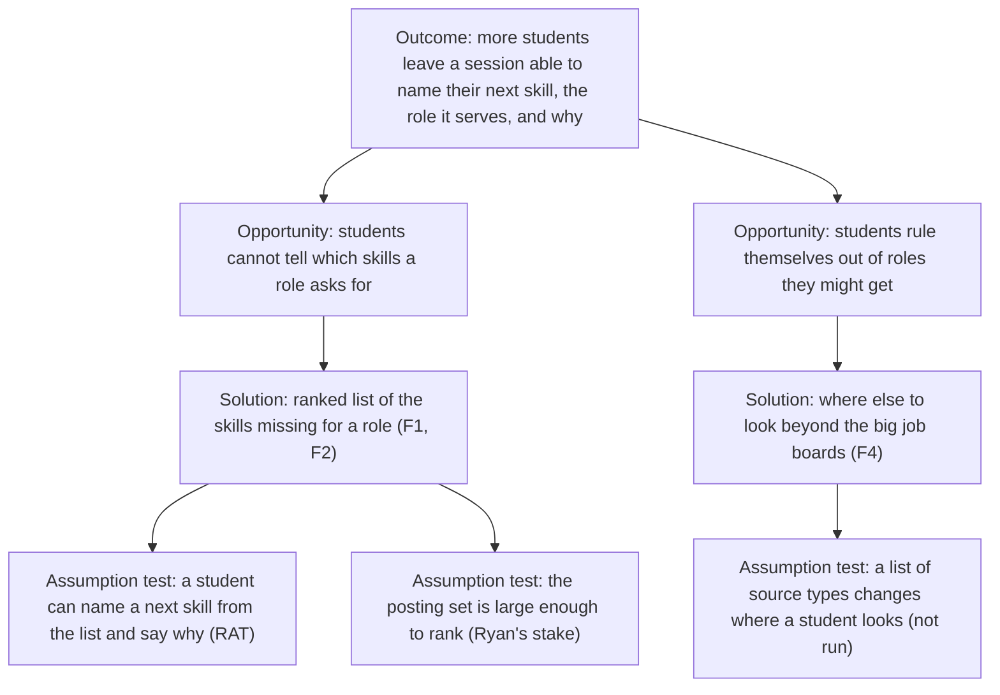

# EVALS.md

Accountable: Prince (Reviewer and Evaluator, Phase 2).

## Opportunity Solution Tree

Written 2026-10-21, after F1 was deployed and checked by hand on 2026-10-20. The Phase 1 slots for this tree, the RAT, and the eval list were empty, so all three are new in Phase 2. None of the evals below had run when this was written.

## Riskiest Assumption (RAT)

**Assumption.** A student who sees the ranked gap list for a role can name the next skill they would learn and say why, without help.

**Why this one.** The Outcome in PROJECT.md depends on it. No interview tested a ranking, and the posting set is a sample the team wrote, so nothing yet shows the list works as an answer.

**Test.** Three testers, each a student targeting one of the roles in the deployed set (Frontend Developer, Data Analyst, and IT Support Specialist). A named team member sits in with each tester, and the notes record a role description only. Each tester uses the deployed page with their own skills. Order matters: first ask judgment question J1 below, then tell the tester the postings are a sample set the team wrote, then ask: "What would you learn next, and why?"

**Pass.** At least 2 of 3 testers name a skill that is in the top five missing skills on their own screen and give a reason that refers to the list, such as its counts.

**Fail.** 0 or 1 of 3. That means the list alone is not an answer, and the next step is the explanation around it, not more postings.

**Changes to this plan** are recorded here with a date before the test runs.

**Plan changed 2026-10-22, before the first session.** Only two testers are available by the deadline, so the RAT runs with two: a full-time software engineer who graduated with a CS degree, and a junior looking for an internship. The pass line becomes both testers (2 of 2). The judgment evals scale the same way: J1 passes at 2 of 2 and J2 passes at 2 of 2. A 1 of 2 result is a fail. The result will state its limits: two testers, both friends of the team, and one of them is a graduate and not a student.

**RAT result (2026-10-22):** The assumption did not hold. Both testers named a skill that was in the top five missing skills on their own screen (2 of 2). Only one gave a reason that referred to the list. The CS graduate said the skill must have been highlighted for a reason, so I counted him as passing on the plan's wording, though he gave no count or rank and leaned on having seen the skill in real applications. The junior's reason was about his own coursework and the general value of SQL, and did not refer to the list. That is 1 of 2 passing, or 0 of 2 if the first reason is read as not referring to the list. The pass line was 2 of 2 either way. J1: 1 of 2 (pass: 2 of 2). J2: 0 of 2 (pass: 2 of 2). Per the plan, a fail means the list alone is not yet an answer, and the next step is the explanation around it, not more postings.

| Session | Tester (role description) | Role on page | Skills entered | Skill named | In top five | Reason refers to list | J1 | J2 |
|---|---|---|---|---|---|---|---|---|
| 1 | CS graduate, full-time software engineer | Frontend Developer | HTML, Java, React | TypeScript | Yes | Borderline, counted Yes | Yes ("made up") | No, no date found |
| 2 | Junior, internship search | Data Analyst | Python, Git, JavaScript | SQL | Yes | No | No (assumed web scraped) | No, no date found |

Top five missing skills on screen. Session 1: TypeScript, Next.js, Tailwind CSS, GraphQL, Jest. Session 2: SQL, Excel, Power BI, Tableau, Pandas.

Present: Prince ran and noted both sessions alone.

Limits: One is a graduate and not a student. Both named the skill ranked first, and their reasons do not show whether the list or prior belief led them there. F1-4's code eval passes and DDR-004 records a collection-date line on the page, so the date is there. Neither tester noticed it.

## Evals Planned for Phase 2

Code evals run with `npm test`. Ten call the deployed Worker and one reads the files in `public/`. The only requests that change anything are the write methods in E8, and the Worker should refuse them.

| ID | EARS row | What it checks |
|---|---|---|
| E1 | F1-1 | `/api/roles` lists only roles that have postings |
| E2 | F1-3 | Capitalization and extra spaces do not change a result |
| E3 | F1-4 | Every result carries the collection date |
| E4 | F1-5 | No skills gets a 400 and no result |
| E5 | F1-6 | A role with no postings is named back and no gap is shown |
| E6 | F1-7 | Holding every skill reports no gap |
| E7 | F1-8 | No database key or binding appears in browser files |
| E8 | F1-9 | POST, PUT, PATCH, and DELETE on `/api/postings` return 405 |
| E9 | F2-1 | Missing skills are ordered by count, highest first |
| E10 | F2-4 | Equal counts are in alphabetical order |
| E11 | F2-8 | No count is larger than the total postings shown |

Not covered by a code eval. F1-2 is exercised by every test that reads a gap. F1-10 is checked by reading `seed.sql` and `worker.js` in review. F2-3 and F2-5 describe what the page shows, and the deployed Worker returns no first-gap or small-sample field. F2-2 is covered in part by E11.

Judgment evals, run with the same three testers:

- **J1.** Before being told anything, does the tester say the postings are made up or a sample the team wrote? Pass: at least 2 of 3.
- **J2.** Can the tester say how old the data is without being pointed to it? Pass: 3 of 3 find the collection date.

Stake measurements, run by the Evaluator:

- **S1.** Ryan's latency stake: 20 warm requests and 20 first requests after 10 minutes idle, against the deployed Worker.
- **S2.** Ryan's ranking-stability stake: see the status line under it.

## Prediction Stakes

Each member commits their own stake, in their own commit, before any Phase 2 code. Predictions are never edited; results are written beneath them.

### Prince (Specifier)

Committed before the bolt.new probe on FEATURES.md

- **Tight:** bolt.new will add a login, signup, or other authentication screen, even though FEATURES.md never mentions access.
- **Loose:** bolt.new will invent its own sample posting data in the code instead of calling an outside API or reading data we supplied.
- **Open:** bolt.new will add at least one library or framework beyond plain HTML, CSS, and JavaScript.

Results: 

- Tight (2026-10-08): false. bolt.new added 0 login or signup screens. Its file list showed none, and its migration says the app has no authentication.
- Loose (2026-10-08): mostly true. bolt.new generated 89 postings, in a seed migration loaded into a Supabase database, not in the page code. The app reads them through Supabase.
- Open (2026-10-08): true. bolt.new added 18 direct packages, including React, Vite, TypeScript, Tailwind, a Supabase client, and Lucide icons.
> The eval list and the RAT are the Reviewer's artifact and are not written yet,
> so this stake names what it measures in words rather than an eval number.
> Renumber the headings to match once the list exists; do not edit the numbers
> in the predictions themselves.

### Stake: Ryan Linde (Architect), committed 2026-10-07

**Is the hand-collected posting set big enough to rank skills at all?**
ADR-001 accepts a frozen, hand-collected posting set because live posting data
is paid or restricted. That is the decision I am most likely to be wrong about,
so it is the one I am staking.

I predict we need **at least 120 postings for a single role** before the top
five skills stop moving. Measured by dropping a random 10% of the postings and
recomputing the ranking, five trials per set size: at 60 postings **at least 3
of 5 trials** change the top five; at 120 postings **at most 1 of 5** does.

If the ranking is already stable at 60, the Consequences section of ADR-001 is
too pessimistic and the collection work is smaller than I told the team. If it
is still unstable at 120, the product does not have a data problem it can fix
by collecting harder, and we should reopen the Gate rather than ship a ranking
we cannot defend.

**Resolution (2026-10-22, Evaluator):** Not run. The prediction names 60 and 120 postings for a single role. The deployed set has 28 postings across three roles (Frontend Developer 12, Data Analyst 10, IT Support Specialist 6), so neither size exists. No number was measured, so the prediction is neither confirmed nor contradicted. Testing it needs a set of at least 120 postings for one role. The condition in the stake that would reopen the Gate (still unstable at 120 postings) was not reached, and neither was the condition that would shrink the collection work (stable at 60).

**Does the Worker stay fast enough to feel like a page, not a job?**
The Gate scored team capability 4 for Build largely on the fact that all of us
have deployed a Worker. Cold start on D1 is the part of that I am least sure of.

I predict **20 of 20 warm requests to the gap endpoint return under 1.5 s** on
campus Wi-Fi, and **at least 4 of 20 first requests after 10 minutes idle go
over 1.5 s**. If cold starts are not visible at all, the capability score of 4
was conservative and I should say so in writing rather than quietly bank it.
**Status (2026-10-21, Evaluator):** Method, recorded before the first run. evals/latency.js sends one priming request, then 20 back-to-back requests (warm), then 20 requests that each follow 10 minutes with no other request from me (cold), all to POST /api/gaps for Data Analyst. A request is slow at 1500 ms or more. Non-200 responses and network errors are counted separately as failed. The stake says campus Wi-Fi. This run is from a GitHub Codespace, so it measures the Worker from a datacenter and not from campus.

Interrupted measurement, recorded 10/21/26. The planned method was 20 warm and 20 cold requests in one run. The latest run began at 10:30 PM and finished 20 warm and 5 cold requests. Its last row is cold 5 at 11:38 PM ET. The script was not running at 11:54 PM ET, and cold 6, due at about 11:48 PM ET, has no row. The cause was not confirmed: probably the Codespace stopping. An earlier run began about 5:10 PM ET and stopped partway, and its rows are in evals/latency-results-run1.csv. Correction to the method line above: every run was from a GitHub Codespace, a datacenter network, and not from campus Wi-Fi as the stake says.

The first run, started about 5:10 PM, stopped at TIME after 6 cold requests because CAUSE. Its rows are in evals/latency-results-run1.csv. The second run uses the same method.

**Resolution (10/21/26, Prince):** Measured from a GitHub Codespace, not campus Wi-Fi, against the deployed Worker, POST /api/gaps for Data Analyst. Warm: 20 of 20 requests returned under 1.5 s (slowest WARM_MAX ms), so the warm half of the prediction held on this network. Cold: only 5 of the planned 20 requests were measured, and 0 of them went over 1.5 s (slowest COLD_MAX ms). The prediction was at least 4 of 20 over 1.5 s. Five fast results do not rule it out, because 4 of the 15 unmeasured requests could still have been slow, so the cold half is not resolved. Failed requests: 0 in both phases.

## Where the Stakes Disagree

Prince's and Ryan's stakes measure different things, so none of them disagree. Aaron and Canon committed no stake before Phase 2 code, so there is no stake from either to compare or resolve.

---

## Final Resolution Appendix — 2026-10-29

### Final stake states

- **Prince Tight — resolved, false.** The generated app added no authentication
  screen.
- **Prince Loose — resolved, mostly true.** The generated app placed its 89
  postings in a seed migration rather than inventing them directly in page code.
- **Prince Open — resolved, true.** The app added dependencies beyond plain
  HTML, CSS, and JavaScript.
- **Ryan ranking stability — final unresolved/not run.** The required 60- and
  120-posting single-role datasets do not exist, and the existing 28-posting
  deployment was not sufficient for the stake.
- **Ryan Worker latency — final partially resolved.** The 20 warm requests passed
  from GitHub Codespace, while only 5 of the required 20 cold requests were
  measured. The cold half is not confirmed, and the campus-Wi-Fi method was not
  met.

### Judgment Evals for Retrospective Claims

Each claim is graded independently by two graders (AI and Human which is Copilot and Aaron). Common rubric:
**2 = supported** when the claim follows directly from the cited evidence;
**1 = partially supported** when the evidence establishes some but not all of
the claim; **0 = unsupported** when the evidence does not establish the claim.
Agreement means both graders assign the same score.

- **JE1 — RAT verdict.** Claim: the retrospective says the ranked list did not
  reliably make the skill choice and explanation visible, because only one of
  two testers gave a list-referential reason. Graders: Aaron and Copilot.
- **JE2 — Net-hours calculation.** Claim: the retrospective's 32.85 net hours
  saved is the sum of the absolute signed Net figures in DDR-001 through
  DDR-013. Graders: Aaron and Copilot.

**JE1 result — 2026-10-29, Evaluator:** Supported by both graders: Aaron: 2/2
and Copilot 2/2. Agreement: 2/2. The RAT table and limits support the stated
conclusion. Neither grader was present for the two sessions; Prince ran both
sessions and recorded the notes being graded. JE1 confirms that the
conclusion follows from the recorded evidence, but it does not independently
verify the underlying sessions.

**JE2 result — 2026-10-29, Evaluator:** Supported by both graders: Aaron
and Copilot 2/2. Agreement: 2/2. The cited absolute values sum to 32.95:
0.1 + 1.7 + 4.6 + 4.2 + 3.15 + 2.0 + 1.65 + 5.5 + 1.5 + 0.5 + 1.5 + 2.8 + 3.75 = 32.95.